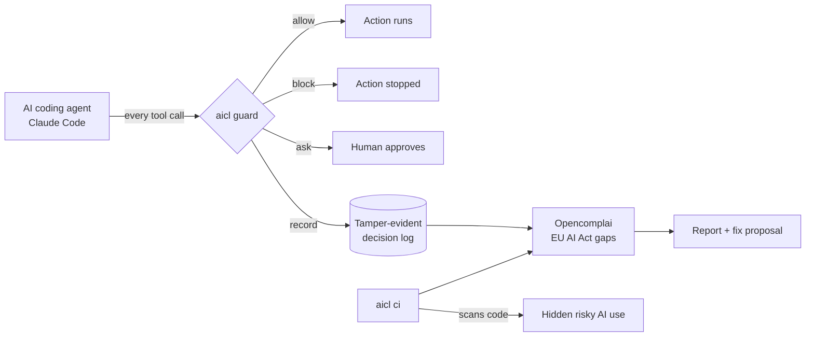

# AI Compliance Layer (aicl)

**A safety guard for AI coding agents that turns every decision into EU AI Act evidence.**


AI coding agents like Claude Code and Cursor can run shell commands, edit files and call external tools.
Security tools such as Knostic's Kirin stop dangerous actions in real time, but leave no regulatory paper
trail. Compliance tools such as [Opencomplai](https://github.com/Opencomplai/opencomplai) check EU AI Act
paperwork in CI, but never see what an agent actually does.

**aicl connects the two.** It blocks risky agent actions as they happen, and records each decision in a
tamper-evident log that Opencomplai accepts as evidence for the EU AI Act's logging requirement (Article 12).

## How it works



## See it in action

Real output from `aicl demo` (full run in [`docs/demo/demo-output.txt`](docs/demo/demo-output.txt)):

| What the AI agent tried | aicl decision |
|---|---|
| Edit a source file | ✅ Allowed |
| `rm -rf` a folder | ⛔ Blocked: destructive command |
| Send an API key in a `curl` request | ⛔ Blocked, key redacted from the log |
| Use a tool the team banned | ⛔ Blocked: outside the agent's mandate |
| Call an unapproved GitHub MCP server | ⛔ Blocked: server not on the allow-list |
| Download a web page | 🙋 Asked a human, then allowed |
| Edit the guard's own settings | ⛔ Blocked: self-protection |

Then the evidence check:

- Opencomplai verifies the log's hash chain and flags exactly the blocked actions as out of mandate.
- Changing one character in the log, or deleting the last line, is detected.
- EU AI Act status for logging, human oversight and robustness moves from **Missing** to **Partial**.
  For logging, Opencomplai finds the log by path and does not read its content; `aicl log verify` checks the content.
- The CI step catches face-based ethnicity profiling hidden in an app declared as "sales analytics",
  and proposes a fix. The full report is in [`docs/demo/aicl-report.md`](docs/demo/aicl-report.md).

## Quick start

```sh
git clone https://github.com/Sohamumap/Ai-Compliance-layer && cd Ai-Compliance-layer
make install   # creates .venv and installs aicl plus the Opencomplai CLI
make demo      # 7 checked steps, offline, about 10 seconds
```

No API key is needed. An optional Claude review of the findings runs only when `ANTHROPIC_API_KEY` or `ANTHROPIC_AUTH_TOKEN` is set; `--judge off` disables it.

## Why this exists

This started as a comparison of AI compliance tools: Opencomplai, Kirin, and others. Opencomplai has strong
regulatory machinery but weak detection: on its own published benchmark it finds a third of the risky
held-out programs. Kirin has strong runtime blocking but no compliance mapping. The research behind this
prototype is in [`docs/research/`](docs/research/), starting with
[`03-takeaways.md`](docs/research/03-takeaways.md).

## Honest limits

It is not legal advice, a sandbox, or a replacement for Claude Code permissions. Log
entries are not signed, and there is no remote anchor: anyone who can rewrite both the log and
`.aicl/log-anchor.json` can forge history. No model runs in the hook path. The remediation patch is never
applied to your manifest; aicl writes `system-manifest.proposed.json` next to it. The classifier is a keyword
heuristic: its Art. 5/Annex III mappings are flagged for legal review (ethnicity is read as "race" under
Art. 5(1)(g), which is an interpretation), and it has no Annex III 1(b)/1(c) categories. Other known v0
limits: shell rules are pattern checks, not a shell parser (a command the shell expands in ways aicl cannot
see, such as `$VAR` targets without `cd`, is not resolved; Bash commands over 16 KB go to a human); MCP tools
are checked for secret-file paths but not for writes to protected files; `input_hash` is an unsalted SHA-256
of the tool input (Opencomplai's format), so a low-entropy secret in a command can be guessed offline; several
agents whose logs share a directory share one anchor file and will report an anchor mismatch; a torn last log
line stops logging until fixed by hand (loud: hook exit 1, deadletter, CI FAIL); a profile from `ant auth
login` is not detected as a judge credential.

---

## Components

- **Runtime guardrail.** `aicl hook pre|post` is a Claude Code `PreToolUse`/`PostToolUse` hook. It decides
  allow / deny / ask against the agent mandate declared in `system-manifest.json` plus a deterministic rule
  set (destructive shell, secrets in input, prohibited or undeclared tools, MCP server allow-list, network
  egress, self-protection). It appends every deny and every executed tool to `agent-log.jsonl` in
  Opencomplai's hash-chain format (checked by `opencomplai agents verify-log`). `opencomplai gaps` finds the
  log by path, which moves Art. 12 from MISSING to PARTIAL; it does not read the log's content.
- **Agentic CI.** `aicl ci` runs `opencomplai check --scan --with-gaps` and `agents verify-log`, adds an AST
  classifier (Python only: other languages are reported as "not assessed") that flags what the declaration
  hides (for example Art. 5(1)(g) biometric categorisation), optionally asks Claude to review the findings
  (only when `ANTHROPIC_API_KEY` or `ANTHROPIC_AUTH_TOKEN` is set; `--judge off` disables it), and writes
  `aicl-report.md/.json` plus an RFC 7386 manifest patch and code actions.

## Install and demo (details)

```sh
make install        # uv venv + editable install with the dev extra (pins opencomplai==0.12.0) and llm extra
make demo           # .venv/bin/aicl demo: 7 asserted steps, offline, about 10 s
make test           # pytest; tests marked external need the opencomplai binary (auto-skipped without it)
```

`aicl demo` copies the bundled `shopper-insights` fixture to a temp dir, runs `aicl init`, replays nine
synthetic Claude Code hook payloads (hand-written to the documented contract) through the real hook
subprocess, verifies the chain (and two tampered copies), runs `aicl ci` and re-checks the proposed manifest.

## Use it on your repo (Claude Code)

1. Declare your agent in `system-manifest.json` under `agent_inventory` (tools, `mandate.permitted_actions`,
   `prohibited_actions`, scalar `limits` knobs, `guardrails`, `logging.decision_log_ref`).
2. `aicl init --repo .` merges the hooks into `.claude/settings.json` (`PreToolUse`, `PostToolUse` and
   `PostToolUseFailure`; matcher `^(Bash|Edit|Write|Read|WebFetch|mcp__.*)$`, anchored so `TodoWrite` and
   `NotebookEdit` stay out; command `"<python>" -m aicl hook pre|post`, timeout 20 s).
   It also writes `docs/human_oversight.md` (Art. 15 guardrail evidence) and adds a `human_oversight` block
   to the manifest (on Opencomplai 0.12.0 the block moves Art. 14 to PARTIAL), then runs `opencomplai agents check`.
3. Run `aicl log verify agent-log.jsonl --anchor --external` and `aicl log status` locally, and `aicl ci` in CI.
   Exit codes: 0 PASS, 1 FAIL, 2 config error, 3 opencomplai unavailable.

A repo without `system-manifest.json` is not governed: the hook prints nothing and exits 0. In a governed
repo, an internal error becomes `ask`, or `deny` with `--fail-closed` / `AICL_FAIL_CLOSED=1`. The hook never
emits `allow`, so your own permission prompts stay in force; add `permissions.deny` rules as a second layer.

**Ungoverned in v0** (outside the matcher, not logged): Grep, Glob, Task, TodoWrite, WebSearch, NotebookEdit.
**Cursor:** enable its third-party hook import to reuse `.claude/settings.json` (not verified here; no native writer).

## Licence boundary

aicl never imports `opencomplai`, `opencomplai_core`, `opencomplai_cli` or `opencomplai_ai`. It only calls the
`opencomplai` executable (subprocess argv, stdout JSON, exit codes, files it writes). The decision-log format
is reimplemented with `hashlib`/`json`. `tests/test_boundary.py` enforces this (`make boundary`). The fixture
and samples are our own. aicl's own licence is not decided yet.

## Read more

- `docs/design/DESIGN.md`: the v0 design (contracts, policy and evidence model, demo script, decisions).
- `docs/research/`: Opencomplai vs Kirin, and the verified integration facts this prototype is built on.
